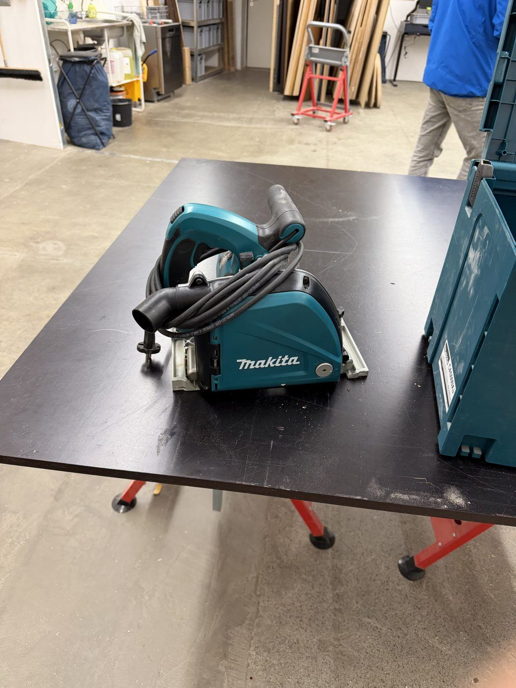
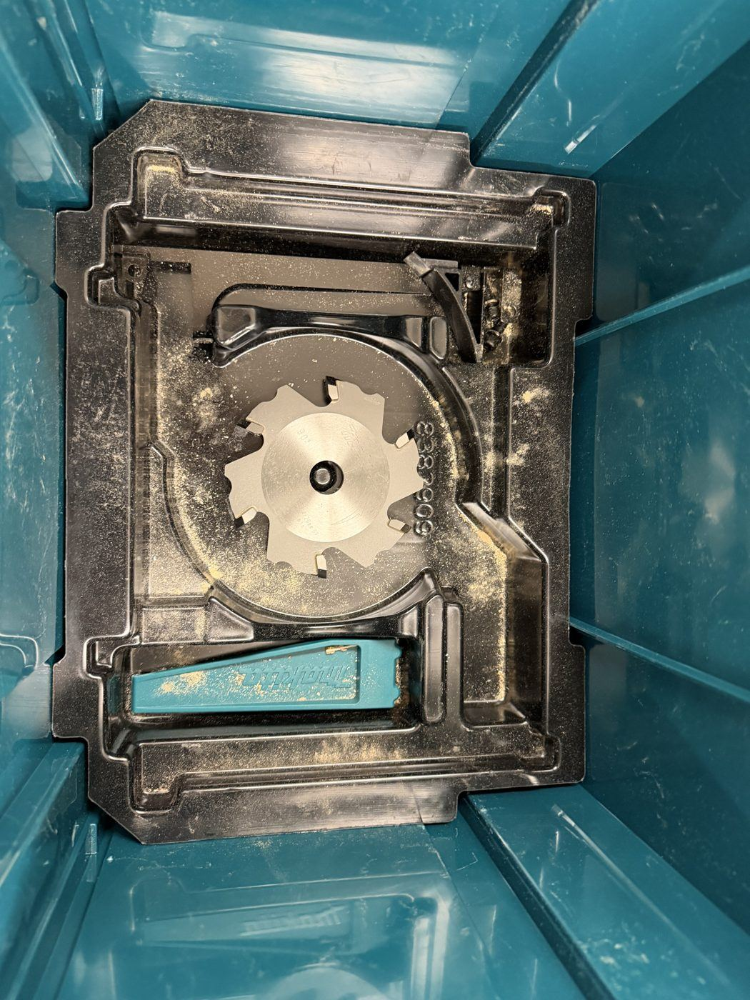

# Makita Aluminium Track Saw

{ width="360" }

| | |
|---|---|
| **Access** | Woodworking 101 Required |
| **PPE** | Safety glasses, hearing protection, long sleeves. No gloves while cutting. |
| **Use it for** | Straight cuts in aluminium sheet and aluminium composite panels (e.g. Dibond), on the same track as the [wood track saw](track-saw.md) |

This saw is for **aluminium only**. Wood goes on the [wood track saw](track-saw.md), which has a different blade and guard.

## Safety

- **Clamp the panel and the track.** Metal is slippery and the saw pulls harder than in wood. Support both sides of the cut so neither piece drops.
- **Chips are hot and sharp.** They fly out of the saw at high speed. Wear safety glasses and long sleeves, and keep other people away from the chip outlet.
- **Set the cut depth** just a few millimetres deeper than the material.
- **Wait for the blade to stop** before lifting the saw off the track.
- **Don't touch the blade or fresh cut edges** right after cutting. They're hot and have sharp burrs.

## Rules

- Only after completing Woodworking 101.
- **Aluminium and aluminium composite panels only.** No steel, no stainless steel, no wood.
- Leave the aluminium blade in this saw. Don't swap blades between the two track saws.
- Clean the chips out of the saw and off the track when you're done. Aluminium chips scratch the next person's workpiece.
- Put the saw and its blade box back in the case.

## How to use

1. Mark the cut and line up the track's edge with your marks. Clamp the track.
2. Set the cut depth to the material thickness plus a few millimetres.
3. Connect the [shop vac](shop-vac.md), or be ready to sweep up chips afterwards.
4. Switch on, let it reach full speed, plunge, and push steadily along the track. Don't force it.
5. Release the trigger, wait for the blade to stop, and lift the saw off.
6. Deburr the cut edges with a file.

## Tips

- Cutting slower than in wood gives a cleaner edge and less heat.
- Leave the protective film on the panel while you cut. It protects the surface from chips and scratches.

## Storage

{ width="360" }

The saw lives in its Makita case. The spare blade is stored in the case insert. _[confirm where the case is kept]_
