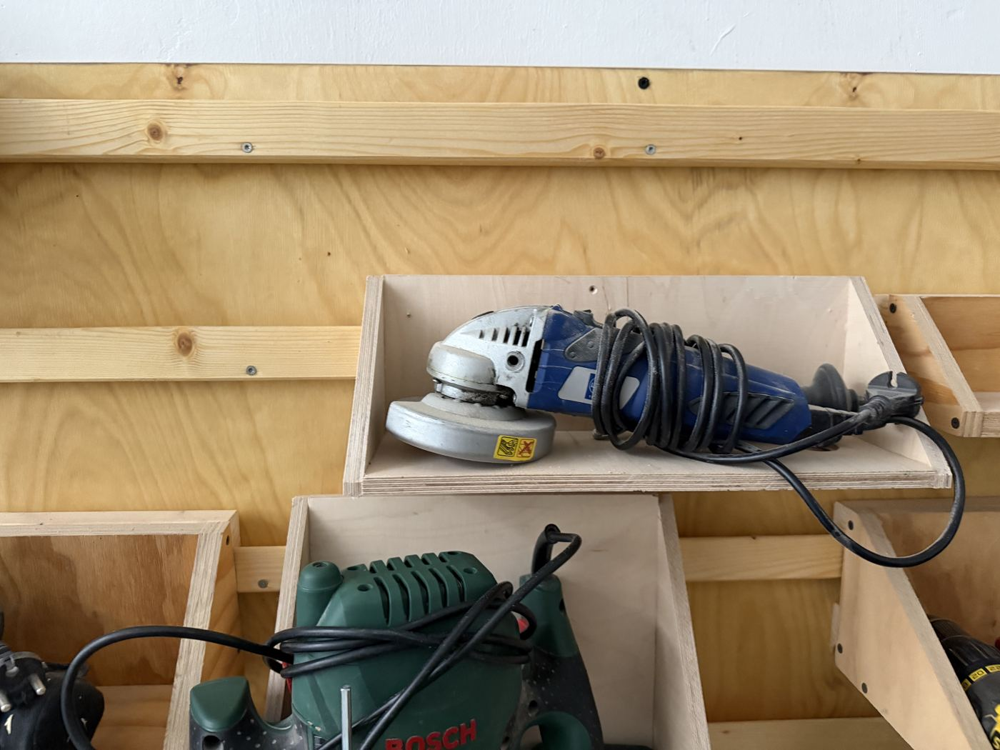

# Einhell Angle Grinder

{ width="360" }

| | |
|---|---|
| **Access** | Sign-off required |
| **PPE** | Safety glasses **and** face shield, hearing protection, work gloves, long sleeves (no synthetic fabric) |
| **Use it for** | Cutting metal (bolts, rebar, sheet), grinding welds and rust, removing paint with a wire or flap disc |

## Safety

!!! danger "One of the most dangerous tools in the shop"
    Discs spin at around 10,000 rpm. A disc that shatters or catches can throw fragments or the grinder itself. Never remove the guard, and never use a disc that's chipped or rated for a lower speed than the grinder.

- **Guard on, between you and the disc**, for every job.
- **Both hands on the tool**, using the side handle.
- **Stand out of line** with the disc when switching on.
- **Cutting discs cut, grinding discs grind.** Never grind with the side of a thin cutting disc. It shatters.
- **Sparks:** clear the area of sawdust, shavings, solvents and rags. Don't grind near the wood area or the dust extractor.
- **Clamp the work.** Never hold metal by hand while cutting it.
- **Wait for the disc to stop** before setting the grinder down.

## Rules

- Only after sign-off by a shop lead.
- Only in the area designated for metal work, away from sawdust. _[confirm location]_
- Unplug before changing discs. Use the pin wrench, not a hammer.
- Never use a wood-carving or saw-tooth disc on this grinder.

## How to use

1. Check the disc for cracks and that its size and speed rating match the grinder.
2. Set the guard so it's between you and the disc, and fit the side handle.
3. Clamp the work.
4. Switch on, wait for full speed, then bring the disc to the work. Let it do the cutting.
5. Release the switch and wait for the disc to stop.

## Tips

- Freshly cut or ground metal is very hot. Let it cool before touching it.
- Flap discs give a smoother finish than grinding discs and are more forgiving to use.
