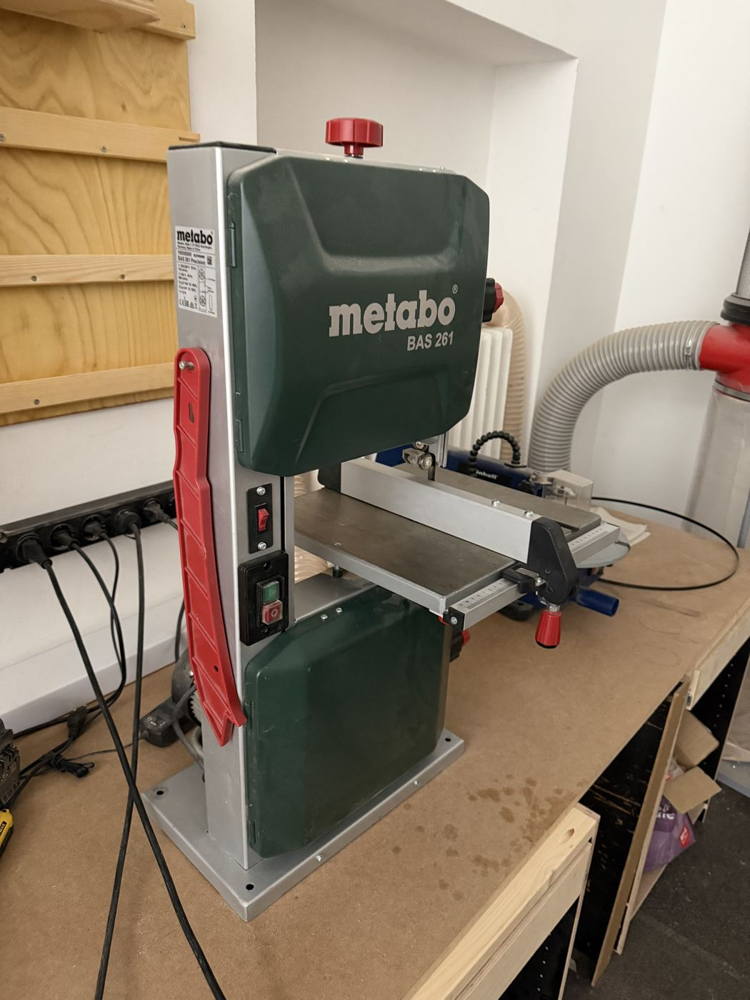

# Metabo BAS 261 Band Saw

{ width="360" }

| | |
|---|---|
| **Access** | Woodworking 101 Required |
| **PPE** | Safety glasses, hearing protection. No gloves. |
| **Use it for** | Curved cuts, cutting thick stock, resawing boards into thinner ones |
| **Product page** | [metabo.com](https://www.metabo.com/com/en/tools/sawing/band-saws/bas-261-precision-band-saw/619008000) |

## Safety

!!! danger "Lower the blade guard"
    Set the upper blade guard about 5 mm above your workpiece for every cut. It's the only thing covering the blade.

- **Keep your fingers out of the blade's path.** Use a push stick for the last part of the cut and on narrow pieces.
- **Round stock rolls.** Never cut a dowel, pipe or log without clamping it in a V-block jig. The blade will grab it and spin it.
- **Don't back out of a long curved cut** while the saw is running. Switch off, wait for the blade to stop, then back the work out. Backing out can pull the blade off its wheels.
- **If the blade breaks** (a loud bang), step back, don't open the doors, and switch off. Tell a shop lead.

## Rules

- Only after completing Woodworking 101.
- Wood only, unless a shop lead fits a blade for another material.
- Don't change blades or tension yourself until you've been shown how.
- Release the blade tension at the end of the day, if that's how you were trained. _[confirm shop policy]_
- Dust extraction on.

## How to use

1. Check the blade isn't cracked or dull and the tension is set.
2. Set the upper guard about 5 mm above the work.
3. Extraction on. Switch on and let the saw reach full speed.
4. Feed gently. Let the blade do the work and don't force it into a tight curve.
5. Finish with a push stick. Switch off and wait for the blade to stop before you remove offcuts.

## Tips

- **Tight curves:** make relief cuts (straight cuts from the edge to just short of your line) first. The waste then falls away in small pieces and the blade doesn't bind.
- The narrower the blade, the tighter the curve it can cut. Wide blades are for straight cuts and resawing.
- For resawing, use the rip fence and a tall board as a guide. Feed slowly.
- Very tight curves and inside cutouts are easier on the [scroll saw](scroll-saw.md).

## Specs

| Spec | Value |
|---|---|
| Max cut height | 103 mm |
| Throat (blade to frame) | 245 mm |
| Motor | 400 W induction motor |
| Included fences | Rip fence, mitre fence |
