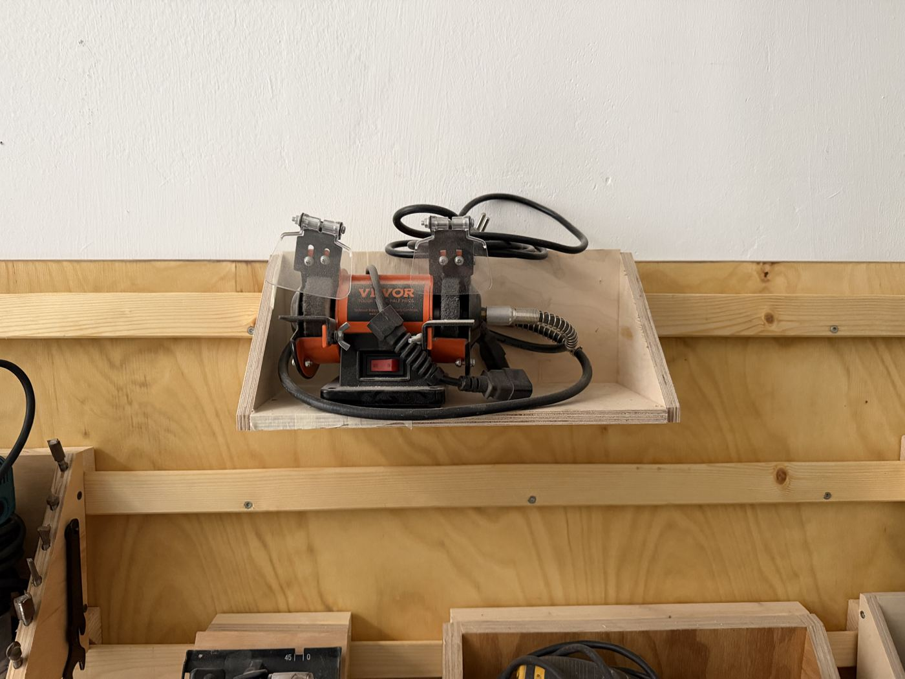

# Polishing / Bench Grinder

{ width="360" }

| | |
|---|---|
| **Access** | Woodworking 101 Required |
| **PPE** | Safety glasses (face shield recommended). No gloves. |
| **Where** | Stored on the wall shelf. It isn't bolted down: clamp it to a bench wherever you need it. |
| **Use it for** | Deburring and touching up metal parts, polishing, small detail work with the flexible shaft |

## Safety

!!! danger "Don't stand in line with the wheel when you switch it on"
    A cracked wheel can burst at start-up. Stand to the side for the first few seconds until it's running smoothly.

- **Eye shields down** and safety glasses on. Sparks and grit fly straight toward your face.
- **Small parts get hot fast.** Hold them with pliers, and dip them in water to cool them.
- **Never use the side of a grinding wheel.**
- **No wood, plastic or soft metals** (aluminium, brass) on the grinding wheel. They clog it and can make it burst.
- **Sparks:** keep the grinder away from sawdust and wood shavings.

## Rules

- Only after completing Woodworking 101.
- Report any wheel that's chipped, cracked or wobbles.
- **Clamp it to the bench** before you switch it on. An unclamped grinder walks and can tip over while running.
- Set it up in a spot cleared of sawdust, away from the wood area's dust.
- Unclamp it and put it back on its shelf when you're done.

## How to use

1. Clamp the grinder firmly to a bench, away from sawdust.
2. Check the wheels for cracks and that the eye shields are in place.
3. Stand to the side and switch on. Wait until it runs smoothly.
4. Hold the work lightly against the front of the wheel and keep it moving.
5. Switch off and let it stop on its own. Don't slow it down by pressing something against it.

## Tips

- For polishing, use the felt or buffing wheel with polishing compound, and present the work below the centre of the wheel so it's pulled away from you, not into the wheel.
- The flexible shaft takes small bits for engraving, carving and polishing in tight spots.
