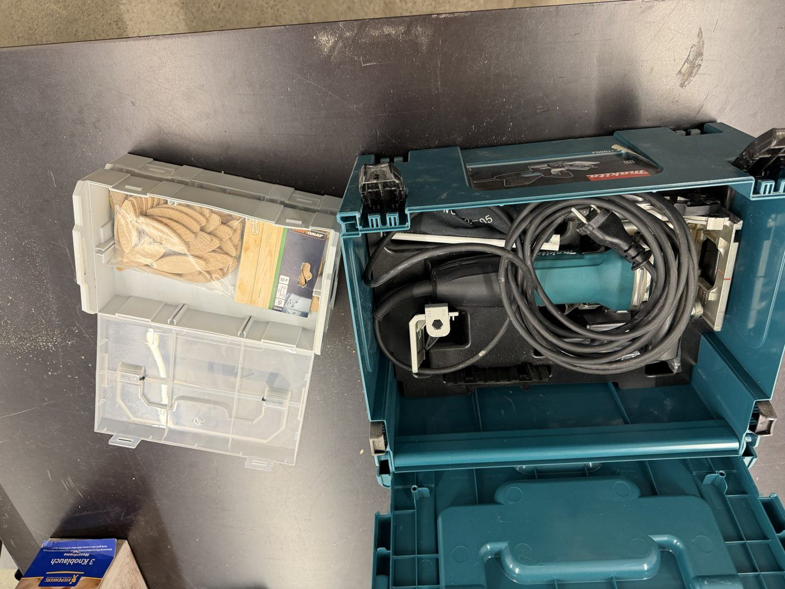

# Makita Biscuit Joiner

{ width="360" }

| | |
|---|---|
| **Access** | Woodworking 101 Required |
| **PPE** | Safety glasses, hearing protection, dust mask. No gloves. |
| **Use it for** | Joining boards edge to edge (tabletops, panels), corner and T-joints in plywood and solid wood, keeping parts aligned during a glue-up |

The joiner cuts matching half-moon slots in both parts. You glue a flat wooden "biscuit" into the slots, the biscuit swells with the glue, and the joint locks.

## Safety

- **Clamp the workpiece**, or press it firmly against the bench stop. The joiner kicks sideways if the work can move.
- **Hold it with both hands** and keep your fingers away from the front plate, where the blade comes out.
- **Let the blade reach full speed** before plunging, and let the plate spring back fully before you lift the tool away.
- Unplug before changing the blade or adjusting the fence.

## Rules

- Only after completing Woodworking 101.
- Wood and wood-based panels only.
- Put the biscuits back in their box, sorted by size, and the joiner back in its case.
- Connect the [shop vac](shop-vac.md) or the dust bag. Biscuit joiners throw a lot of chips.

## How to use

1. Lay out the parts as they'll be glued and draw a pencil line across each joint where you want a biscuit. Every 15–20 cm along an edge is plenty.
2. Set the depth dial to the biscuit size (0, 10 or 20). Use the largest size that fits your material.
3. Set the fence height so the slot is roughly in the middle of the board's thickness. Always reference from the same face on both parts.
4. Line the centre mark on the joiner up with your pencil line, switch on, and plunge. Release and let it spring back.
5. Repeat on the matching part.
6. Dry-fit with biscuits first. Then glue: put glue in the slots (not just on the biscuit), insert the biscuits, and clamp straight away.

## Tips

- Biscuits swell within minutes. Have everything ready before you start gluing.
- Keep slots at least 3 cm from the ends of a board that you'll cut to length afterwards, so the saw doesn't hit a biscuit.
- Store the biscuits sealed. If they've already absorbed moisture from the air, they won't fit.

## Storage

The joiner and its biscuits are stored in the Makita case. _[confirm where the case is kept]_
