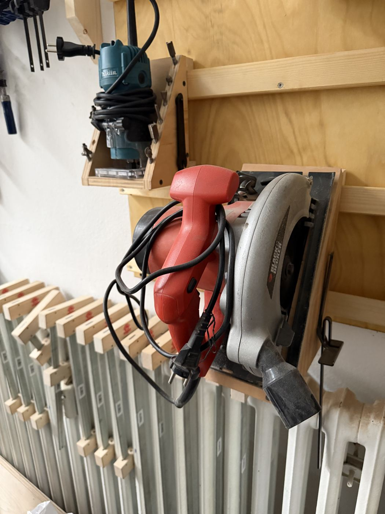

# Circular Saw

{ width="360" }

| | |
|---|---|
| **Access** | Sign-off required |
| **PPE** | Safety glasses, hearing protection. No gloves. |
| **Use it for** | Rough cuts in boards and sheets that are too big for the stationary saws |

For long, straight cuts in sheet material, the [track saw](track-saw.md) is more accurate and safer.

## Safety

!!! danger "Kickback"
    If the blade binds, the saw jumps back toward you. Clamp the work, support it so the cut opens up instead of closing on the blade, and keep both hands on the saw.

- **Clamp the workpiece.** Never hold it with one hand and cut with the other, and never rest it on your knee.
- **Support the work on both sides of the cut**, so the offcut doesn't drop and pinch the blade.
- **Check the lower blade guard** snaps back freely before every use. Never pin it open.
- **Blade depth:** about 5 mm deeper than the material.
- **Wait for the blade to stop** before you lift the saw out of the cut or put it down.

## Rules

- Only after sign-off by a shop lead.
- Wood and wood-based materials only.
- Unplug before changing the blade.

## How to use

1. Set the blade depth to the material thickness plus about 5 mm.
2. Clamp the work so the cut line overhangs your support, with the offcut supported too.
3. Line up the notch on the base plate with your line.
4. Switch on, let it reach full speed, then push steadily forward. Don't twist the saw in the cut.
5. Release the trigger and wait for the blade to stop.

## Tips

- Clamp a straight board as a guide fence for straighter cuts.
- The blade cuts on the up-stroke, so the bottom face stays clean and the top face splinters. Cut with the good face **down**.
