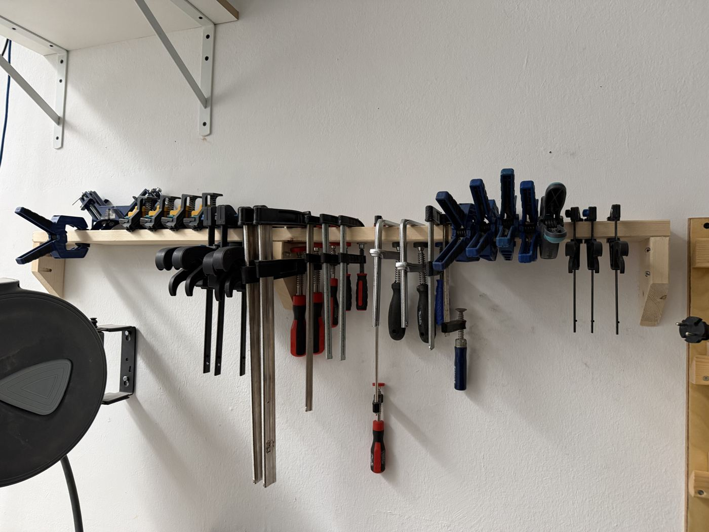
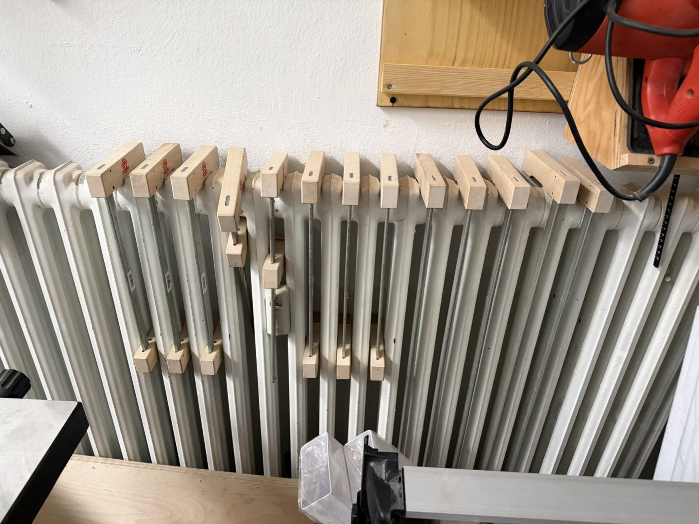

# Clamps

{ width="360" }

{ width="360" }

| | |
|---|---|
| **Access** | Open |
| **Use it for** | Holding work while you cut, drill or rout, and holding glued parts together while the glue dries |

## Types in the shop

| Clamp | Best for |
|---|---|
| **F-clamps / screw clamps** | General holding, strong pressure, clamping work to the bench |
| **Quick clamps (one-handed)** | Fast positioning and light holding. Many can be reversed to push parts apart. |
| **Long bar clamps** (on the radiator) | Wide glue-ups like tabletops and panels |

## Rules

- **Put clamps back** in the rack when you're done. A missing clamp is a problem for the next person's glue-up.
- **Wipe off glue** before it dries. Dried glue on the bars stops the jaws from sliding.
- Don't use clamps as hammers, pry bars or ladder hooks.
- Long glue-ups that need clamps overnight: leave a note with your name and date. _[confirm shop policy on how long clamps can be borrowed]_

## Tips

- **Use scrap pads** between the clamp jaws and your workpiece so the jaws don't dent the wood.
- **Don't overtighten glue-ups.** Firm pressure is enough. Too much squeezes out all the glue and leaves a weak joint.
- **Alternate clamps** above and below a panel glue-up so it stays flat.
- **Dry-fit first.** Do a full clamp-up without glue so you know you have enough clamps and everything closes before the glue starts setting.
