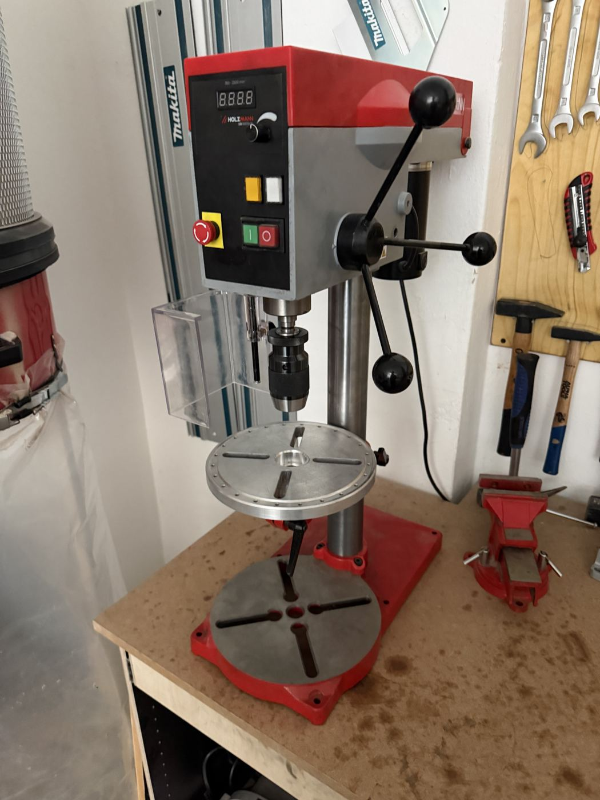

# Holzmann Drill Press

{ width="360" }

| | |
|---|---|
| **Access** | Induction |
| **PPE** | Safety glasses. No gloves. Tie back long hair. |
| **Use it for** | Holes that are exactly square to the surface, repeat holes to the same depth, Forstner bits and hole saws |
| **Product page** | [holzmannshop24.de, SB13B16VN](https://www.holzmannshop24.de/p/holzmann-staenderbohrmaschine-sb13b16vn_230v-zentrierlaser-oder-led-arbeitslicht-oder-variable-drehzahl) |

## Safety

!!! danger "Clamp the work"
    Never hold the workpiece by hand. A bit that catches can spin a board or a piece of metal around at full speed. Use the vise or clamp it to the table.

- **Close the chuck guard** before you start.
- **Remove the chuck key** right after you use it. A key left in the chuck gets thrown out when you switch on.
- **Hair, sleeves and gloves get wound up** in the spindle in a fraction of a second. Tie hair back, roll sleeves up, no gloves.
- **Know where the emergency stop is:** the red button on the front panel.

## Rules

- Induction by a shop lead before your first use.
- Put a piece of scrap wood under your workpiece so you don't drill into the table.
- Clean chips off the table and put the bits back when you're done.

## How to use

1. Fit the bit and tighten the chuck. Remove the key.
2. Clamp your workpiece with scrap underneath.
3. Set the depth stop if you're drilling a blind hole.
4. Close the guard. Switch on and set the speed with the dial.
5. Lower the bit with steady pressure. On deep holes, lift it out every few millimetres to clear chips.
6. Switch off and wait for the spindle to stop before you unclamp.

## Tips

- **Speed:** large bits, hole saws and metal need a slow speed. Small bits in wood can go fast. As a rough guide: 3 mm bit in wood about 2000 rpm, 25 mm Forstner bit about 500 rpm.
- For metal, punch a centre mark first and use cutting oil.
- Drilling many parts the same way? Clamp a fence or stop block to the table so every part goes in the same place.

## Specs

| Spec | Value |
|---|---|
| Chuck | 1–13 mm keyless, B16 |
| Speed | 350–2500 rpm, variable |
| Max drill diameter (steel) | 13 mm |
| Throat | 105 mm |
| Spindle to table | max 270 mm |
| Motor | 300 W |
