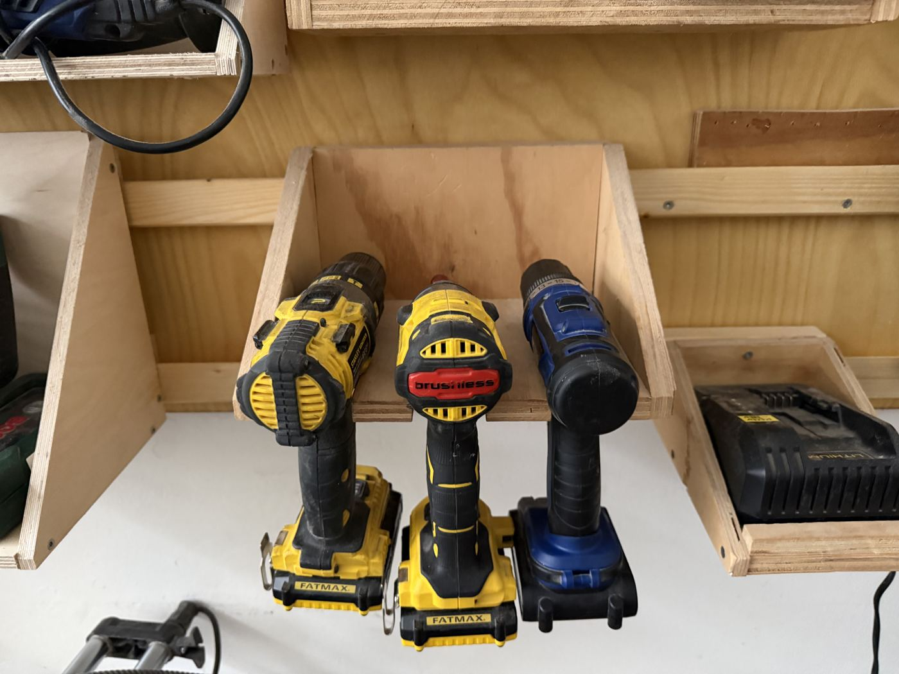

# Drills & Drivers

{ width="360" }

| | |
|---|---|
| **Access** | Open |
| **PPE** | Safety glasses. Hearing protection when hammer drilling. |
| **Use it for** | Drilling holes, driving screws, drilling into concrete and masonry (hammer mode) |

| Tool | Best for |
|---|---|
| **Stanley FatMax hammer drill (Bohrhammer)** | Drilling in wood and metal, and in brick or concrete with hammer mode on |
| **Stanley FatMax impact driver** | Driving long or many screws fast. Takes ¼″ hex bits only. |
| **Lux cordless drill (Akkuschrauber)** | Light drilling and screwing |

## Safety

- **Hold the drill firmly with both hands** for big bits. When a bit catches, the drill twists hard and can sprain your wrist.
- **Clamp small workpieces.** Don't hold them in your hand while drilling.
- **Before drilling into a wall,** check for cables and pipes with a detector. Ask a shop lead before drilling into the building.
- **Never hold a bit or the chuck** while the drill is running.

## Rules

- Put batteries back on the charger when you're done, and tools back on the shelf.
- Use masonry bits only in hammer mode, and wood or metal bits only with hammer mode off.
- Don't use the impact driver to drill large holes. It's made for screws.

## How to use

1. Fit the bit and tighten the chuck (or click the hex bit into the impact driver).
2. Choose direction (forward/reverse), gear (1 = slow and strong for screws and big bits, 2 = fast for small holes), and drill or hammer mode.
3. Set the clutch ring to a low number for screws, so they don't strip or sink too deep. Use the drill symbol for drilling.
4. Start slowly, then increase speed.

## Tips

- Pre-drill holes in hardwood and near the end of a board, so the wood doesn't split.
- A piece of tape around the bit shows you where to stop for a set depth.
- Use the matching bit (PH2, PZ2, Torx) for the screw. The wrong bit strips the screw head.
