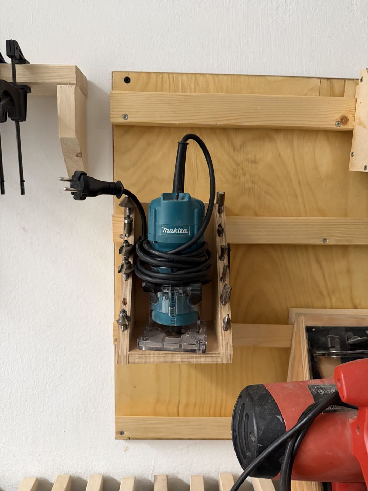

# Makita Edge Router

{ width="360" }

| | |
|---|---|
| **Access** | Woodworking 101 Required |
| **PPE** | Safety glasses, hearing protection, dust mask. No gloves. |
| **Use it for** | Rounding over and chamfering edges, flush-trimming veneer and edging, small profiles and hinge recesses |

## Safety

!!! danger "Feed direction"
    Move the router **against** the bit's rotation: left to right along an outside edge as you face it. Going the other way, the bit grabs and the router runs along the edge on its own.

- **Clamp the workpiece** and hold the router with both hands. It's small, but at about 30,000 rpm it still has plenty of torque.
- **Start with the bit clear of the wood** and let it stop before you put the router down. Always set it down on its side, never on the base with the bit sticking out.
- **Tighten the collet** with the bit shank inserted at least ¾ of the way.
- **Bits with a bearing** need the bearing to run against the edge. Check it spins freely.

## Rules

- Only after completing Woodworking 101.
- Unplug before changing bits.
- Put the bits back in the holder on the wall when you're done.

## How to use

1. Fit the bit and set the depth with the base adjustment.
2. Test the setting on a scrap piece of the same material.
3. Clamp the work. Switch on with the base flat on the work and the bit clear of the edge.
4. Move into the edge and along it at a steady pace, keeping the base flat.
5. Switch off and wait for the bit to stop.

## Tips

- For big profiles, take two passes: a light one first, then the final depth.
- Rout end grain first, then the long edges. Any tear-out at the corners gets cleaned up by the long-grain passes.
- For deep grooves and big bits, use the [plunge router](plunge-router.md).
