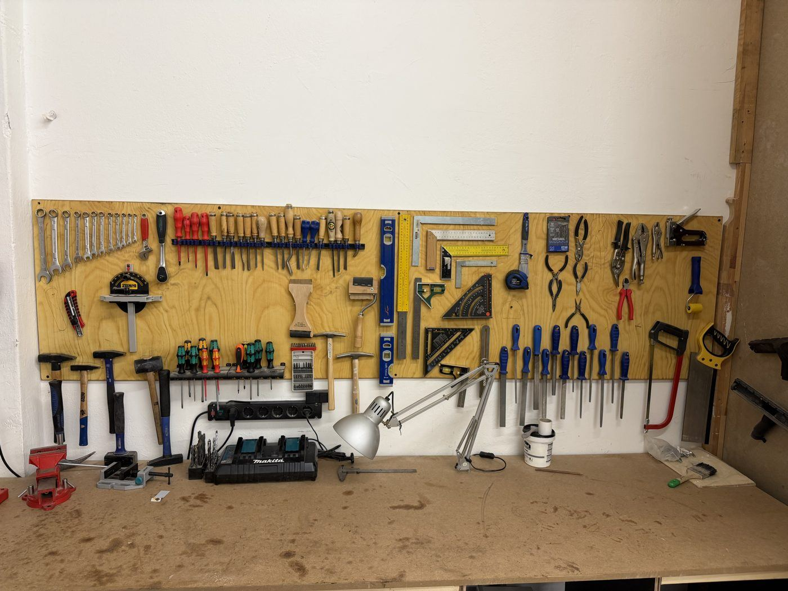

# Hand Tool Wall

{ width="480" }

| | |
|---|---|
| **Access** | Open |
| **What's here** | Chisels, screwdrivers and bits, wrenches, hammers, measuring tools (squares, levels, tape measures), files and rasps, pliers and cutters, hand saws, drill bits, and the Makita battery charger |

## Rules

- **Put every tool back where you found it** when you're done. If its spot is empty, everyone can see something is missing.
- **Don't take tools out of the woodshop** without asking a shop lead.
- **Report broken or worn tools** in Discord (a chipped chisel, a bent screwdriver, a stripped bit) instead of putting them back on the wall.
- **Chisels go back sharp-side protected.** Never leave a chisel lying on a bench edge where it can fall.
- Cordless batteries: put them on the charger when they're empty, and take them off once they're full.

## Tips

- **Chisels:** keep them for wood only. Don't use them as screwdrivers, pry bars or scrapers. Push them by hand or tap with a wooden or rubber mallet, not a steel hammer.
- **Squares:** check the square is square before you trust it. Draw a line, flip the square over and draw again. If the lines don't match, report it.
- **Screwdrivers and bits:** use the bit that fills the screw head completely (PH2, PZ2 and Torx T20/T25 are the most common). The wrong size strips the screw.
- **Measure from the same tape** for a whole project. Two tape measures can differ by a millimetre or more.
