# Woodworking & Carpentry

The woodshop has stationary machines for cutting and dimensioning lumber and sheet goods, hand-held power tools for work on bigger pieces, and hand tools and clamps for assembly. Click a tool to see its safety information, usage rules and tips.

## Access levels

Every tool page shows one of these two levels near the top.

| Level | What it means |
|---|---|
| **Open** | Free to use for all members. |
| **Woodworking 101 Required** | You need to have completed the Woodworking 101 course before using this tool. |

## Stationary machines

-   [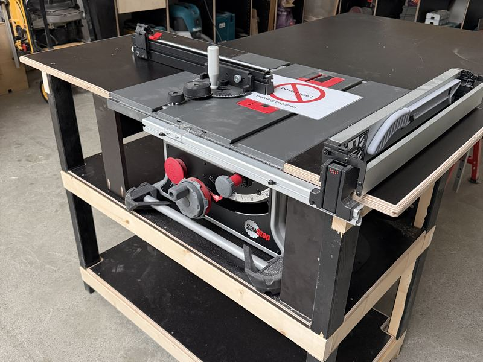](table-saw.md)

    **[SawStop Compact Table Saw](table-saw.md)** 
    Ripping and crosscutting · *Woodworking 101 Required*

-   [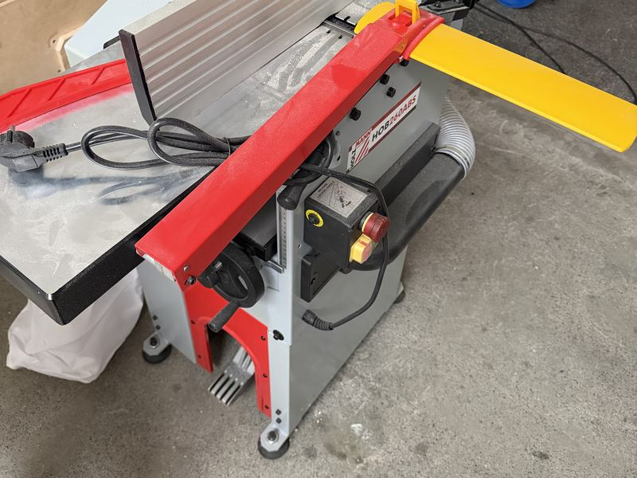](planer-thicknesser.md)

    **[Holzmann Planer / Thicknesser](planer-thicknesser.md)** 
    Flattening and thicknessing lumber · *Woodworking 101 Required*

-   [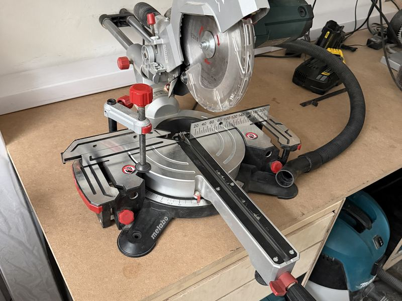](mitre-saw.md)

    **[Metabo Mitre Saw](mitre-saw.md)** 
    Crosscuts and mitres · *Woodworking 101 Required*

-   [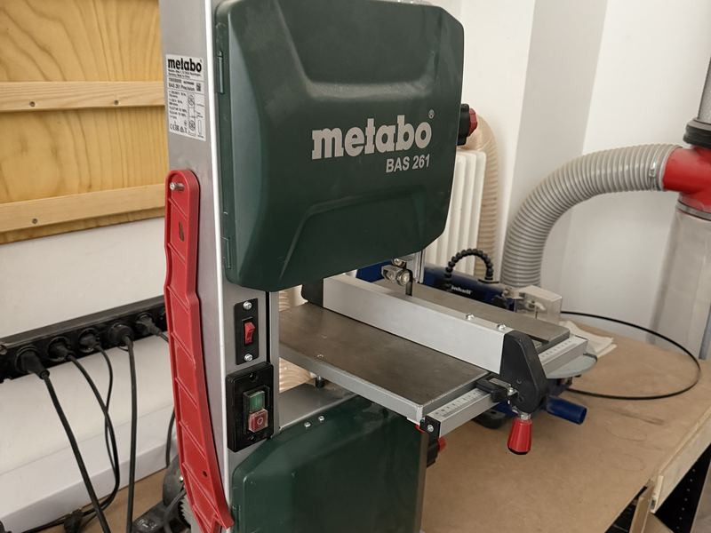](band-saw.md)

    **[Metabo Band Saw](band-saw.md)** 
    Curves and resawing · *Woodworking 101 Required*

-   [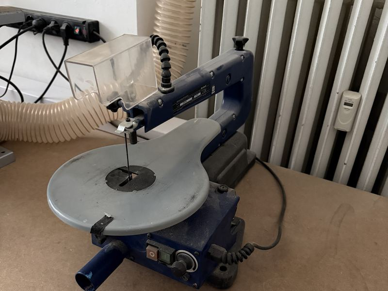](scroll-saw.md)

    **[Einhell Scroll Saw](scroll-saw.md)** 
    Fine curves and inside cutouts · *Woodworking 101 Required*

-   [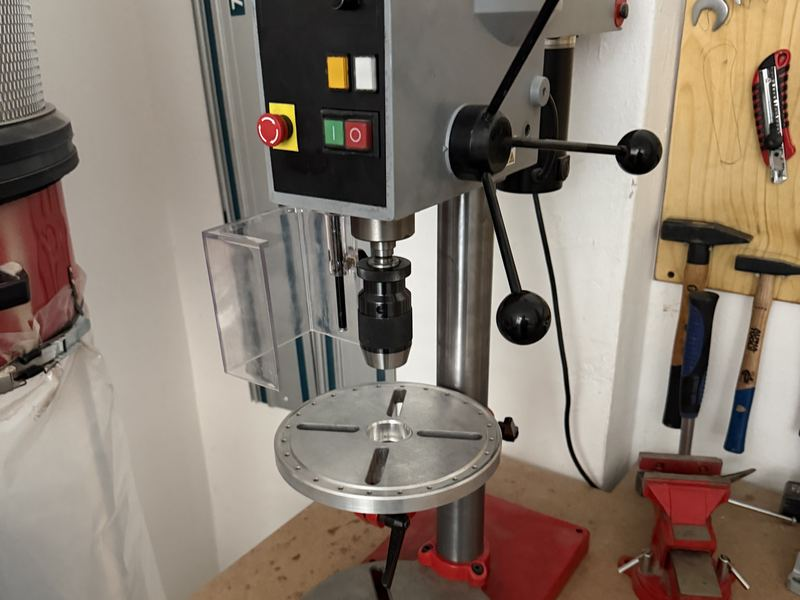](drill-press.md)

    **[Holzmann Drill Press](drill-press.md)** 
    Precise, square holes · *Woodworking 101 Required*

-   

    **[Holzmann Belt / Disc Sander](belt-disc-sander.md)** 
    Shaping and sanding edges · *Woodworking 101 Required*

## Hand-held power tools

-   [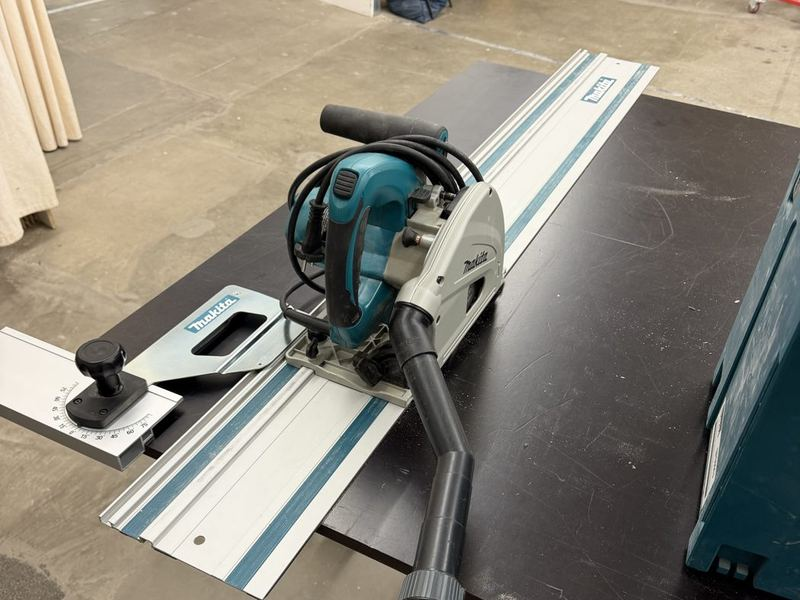](track-saw.md)

    **[Makita Track Saw](track-saw.md)** 
    Breaking down sheet goods · *Woodworking 101 Required*

-   [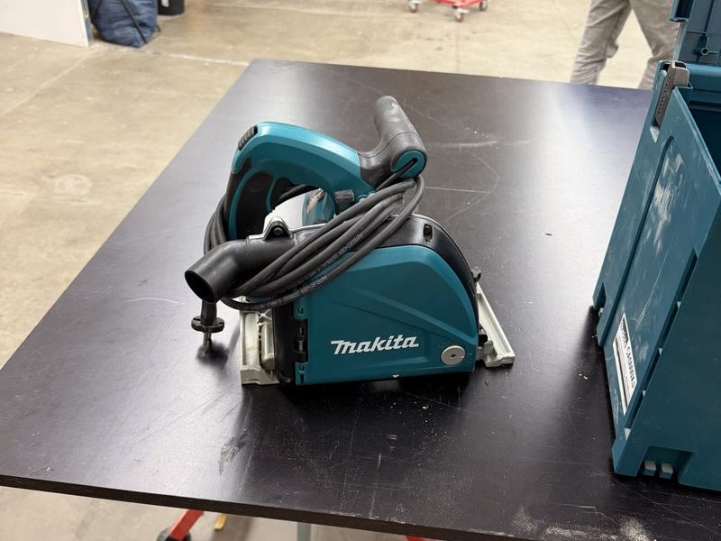](aluminium-saw.md)

    **[Makita Aluminium Track Saw](aluminium-saw.md)** 
    Straight cuts in aluminium panels · *Woodworking 101 Required*

-   [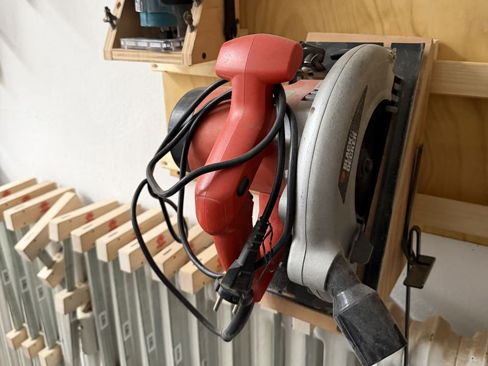](circular-saw.md)

    **[Circular Saw](circular-saw.md)** 
    Rough cuts in boards and sheets · *Woodworking 101 Required*

-   [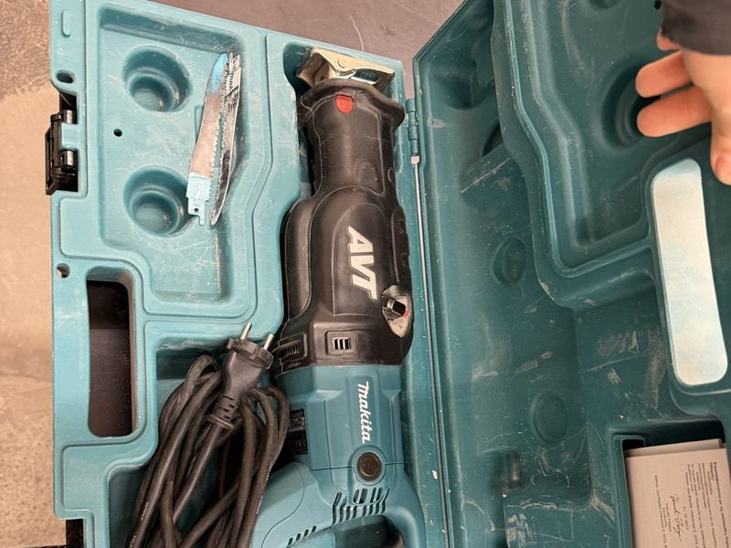](reciprocating-saw.md)

    **[Makita Reciprocating Saw](reciprocating-saw.md)** 
    Demolition and rough cuts · *Woodworking 101 Required*

-   [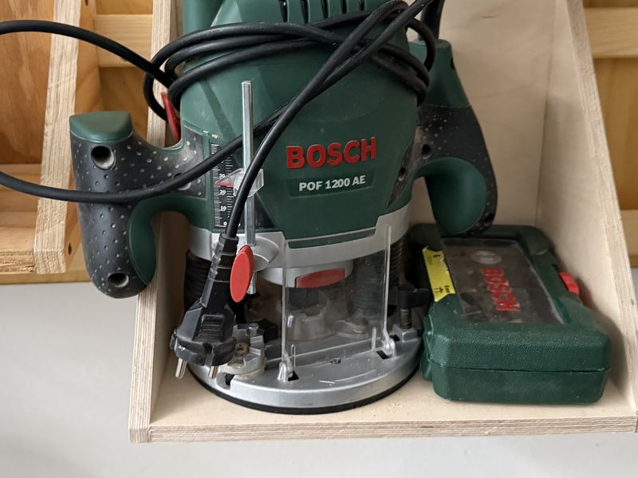](plunge-router.md)

    **[Bosch Plunge Router](plunge-router.md)** 
    Grooves, dados, templates · *Woodworking 101 Required*

-   [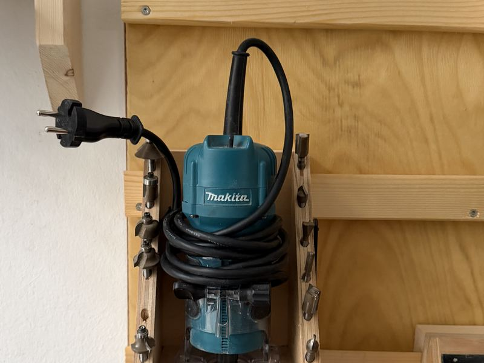](edge-router.md)

    **[Makita Edge Router](edge-router.md)** 
    Edge profiles and flush trimming · *Woodworking 101 Required*

-   [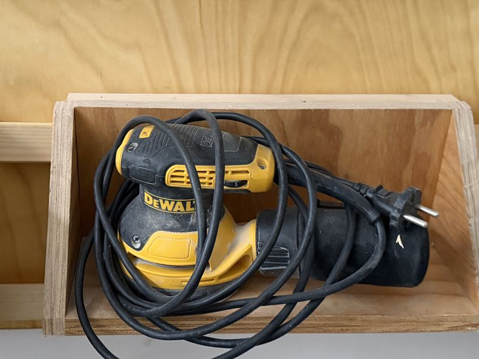](random-orbit-sander.md)

    **[DeWalt Sander](random-orbit-sander.md)** 
    Surface sanding · *Open*

-   [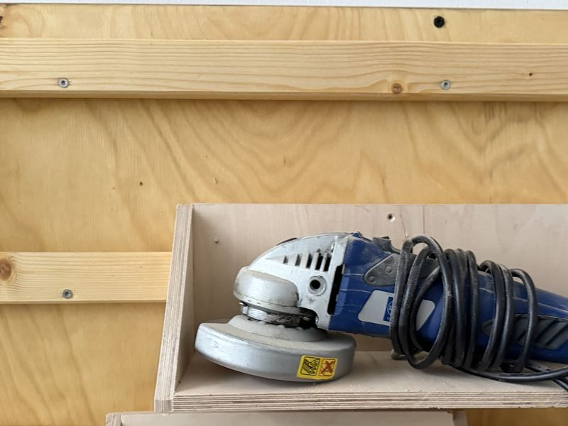](angle-grinder.md)

    **[Einhell Angle Grinder](angle-grinder.md)** 
    Cutting and grinding metal · *Woodworking 101 Required*

-   [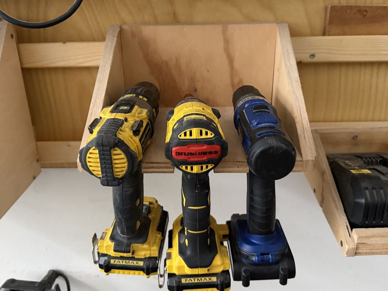](drills-drivers.md)

    **[Drills & Drivers](drills-drivers.md)** 
    Stanley hammer drill and impact driver, Lux drill · *Open*

-   [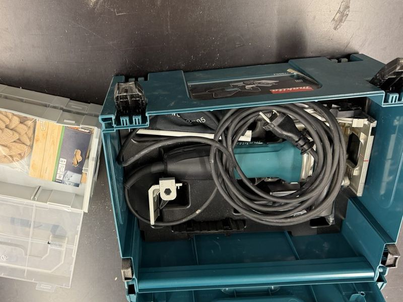](biscuit-joiner.md)

    **[Makita Biscuit Joiner](biscuit-joiner.md)** 
    Edge joints and alignment · *Woodworking 101 Required*

-   [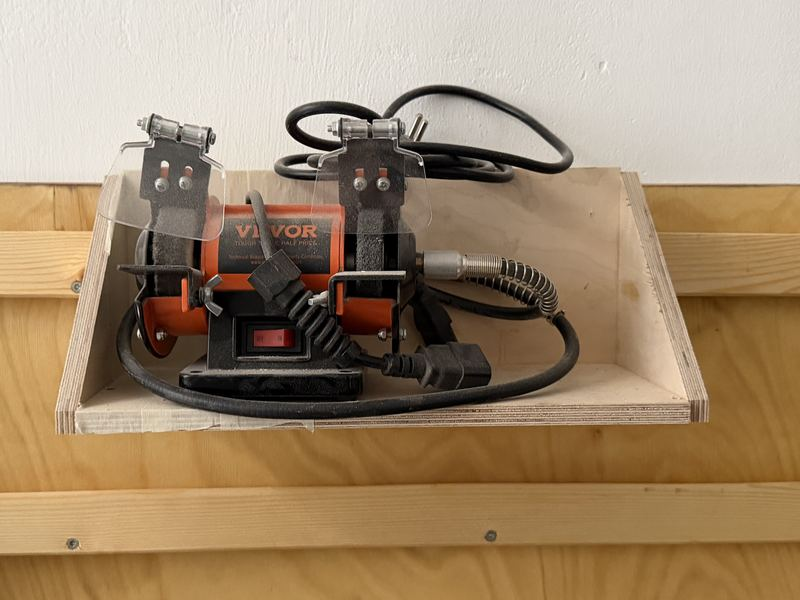](bench-grinder.md)

    **[Polishing / Bench Grinder](bench-grinder.md)** 
    Sharpening, deburring, polishing · *Woodworking 101 Required*

-   [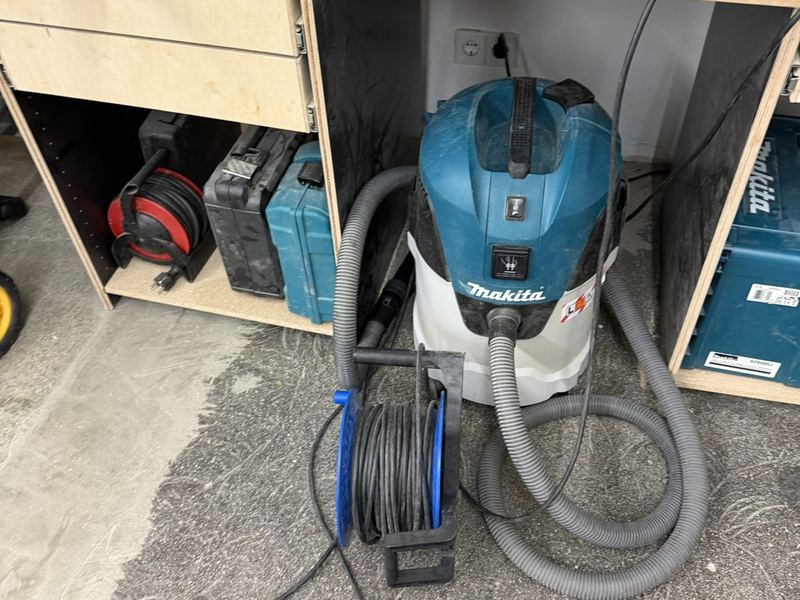](shop-vac.md)

    **[Makita Shop Vac](shop-vac.md)** 
    Dust extraction and cleanup · *Open*

## Hand tools

-   [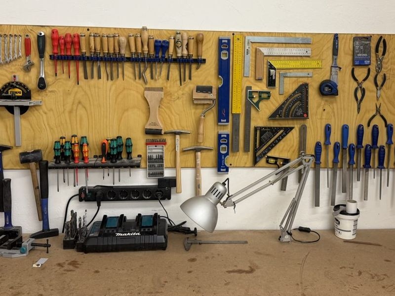](hand-tool-wall.md)

    **[Hand Tool Wall](hand-tool-wall.md)** 
    Chisels, screwdrivers, squares, hammers and more · *Open*

-   [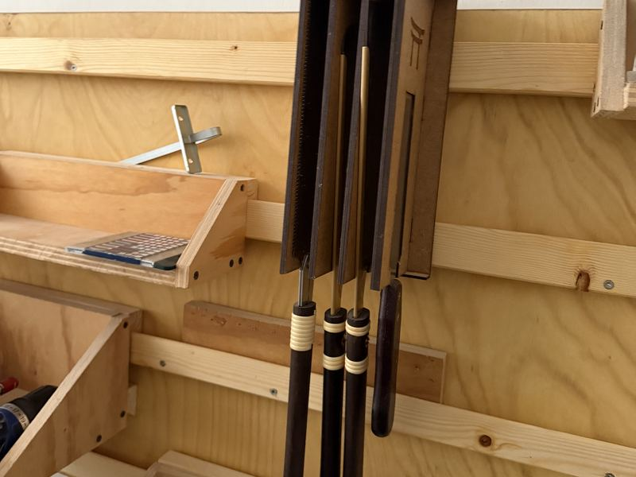](japanese-saws.md)

    **[Japanese Saws](japanese-saws.md)** 
    Fine joinery cuts by hand · *Open*

-   [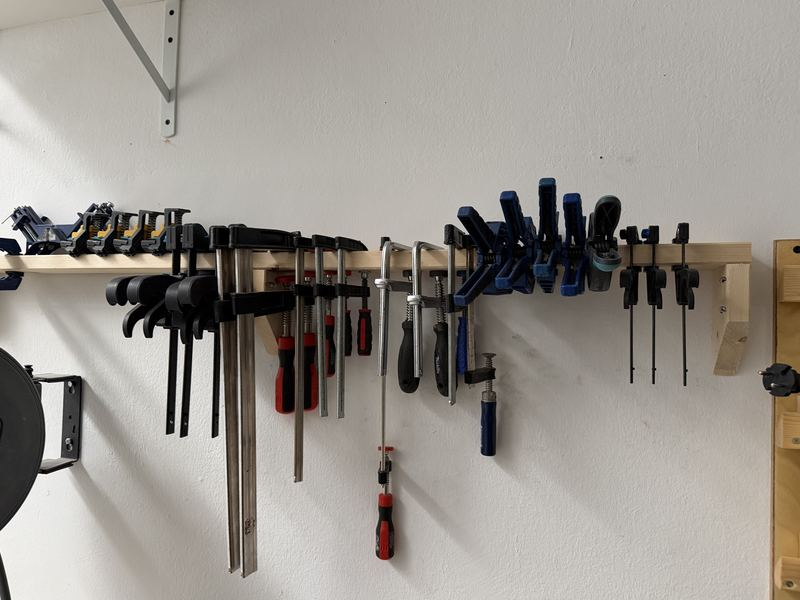](clamps.md)

    **[Clamps](clamps.md)** 
    Glue-ups and holding work · *Open*

## General shop rules

!!! danger "Before you use any power tool"
    Tools marked **Woodworking 101 Required** can only be used after you've completed the Woodworking 101 course. If you're unsure how to use something, stop and ask a shop lead.

- **Eye and ear protection** for every power tool. Wear a dust mask (FFP2 or better) when sanding or cutting MDF.
- **No gloves near spinning blades, bits or belts.** Tie back long hair. No loose sleeves, scarves, lanyards or jewellery.
- **Dust extraction on** for every stationary machine that has a port. Empty the bag when it's full instead of leaving it for the next person.
- **One person per machine.** Nobody stands behind or beside the cut line while a machine is running.
- **Never leave a running machine.** Wait until the blade or bit has stopped completely before you walk away or reach in.
- **Unplug before changing blades, bits or belts.** On cordless tools, remove the battery.
- **No nails, screws or staples in your stock.** Check reclaimed wood with a magnet first. Metal destroys blades and knives and can be thrown back at you.
- **Report damage.** A dull blade, a missing guard or anything that sounds or feels wrong gets reported in Discord right away, and the tool isn't used until it's fixed.
- **Clean up.** Vacuum your machine and the floor around it, put tools back where they belong, and take your offcuts with you or put them in the scrap bin.

**Emergency:** _[first aid kit location, who to contact, how to report an incident]_

## FAQ

**Q: Do I need training before using the woodshop power tools?**
A: For most power tools, yes: you need Woodworking 101. Check the level on each tool's page, and see [Access levels](#access-levels) above.

**Q: _[Can I bring my own wood/material?]_**
A:

**Q: _[What do I do with scrap/offcuts?]_**
A:
