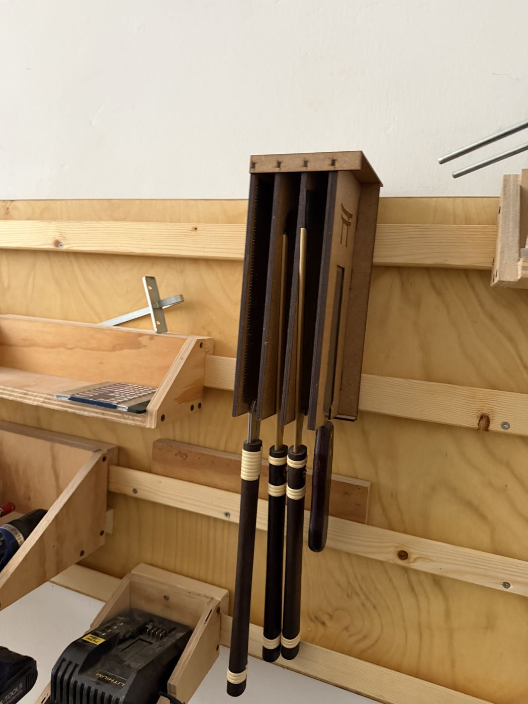

# Japanese Saws

{ width="360" }

| | |
|---|---|
| **Access** | Open |
| **PPE** | None required |
| **Use it for** | Precise hand cuts: joinery (dovetails, tenons), trimming dowels flush, small cuts where setting up a machine isn't worth it |

Japanese saws **cut on the pull stroke**, not the push. That lets the blade be much thinner than a Western saw, so the cut is narrower and more precise.

## Safety

- The teeth are extremely sharp. Carry the saw with the teeth pointing down and hang it back in its holder after use.
- Keep your guiding thumb above the teeth when starting a cut, never in front of them.
- Clamp the work or use a bench hook.

## Rules

- **Wood only.** No nails, screws, MDF with metal edging, or anything else that could damage the teeth. The teeth are hardened and can't be resharpened, so a damaged saw has to be replaced.
- **Don't twist or bend the blade.** It's thin and kinks easily.
- Hang the saws back in their holder. Don't leave them lying on the bench.

## How to use

1. Mark your line all around the workpiece with a pencil or marking knife.
2. Start the cut with a few light pull strokes at a low angle, guiding the blade with your thumb.
3. Saw with long, light strokes. Let the saw's weight do the work and don't push on the return stroke.
4. Finish slowly so the last fibres don't break off.

## Tips

- **Which saw?** A ryoba (teeth on both edges) has rip teeth on one side for cutting along the grain and crosscut teeth on the other for cutting across it. A dozuki (stiff spine) is for fine joinery. A flexible flush-cut saw trims dowels and plugs level with the surface.
- If the saw wanders off the line, don't force it back. Take a few short strokes to steer it gently.
