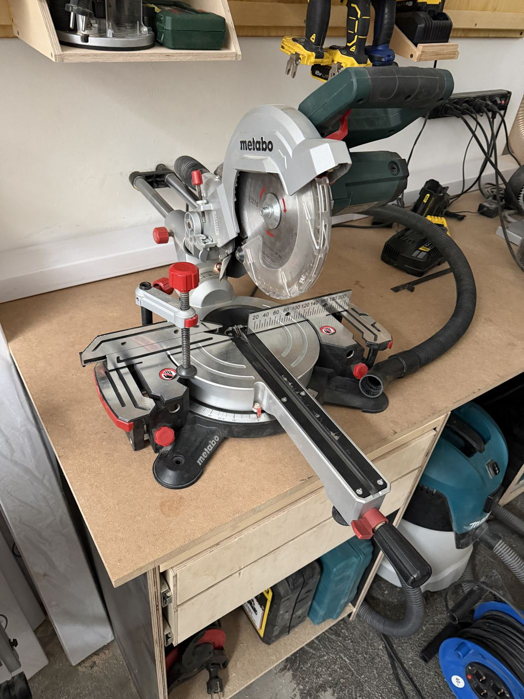

# Metabo Mitre Saw

{ width="360" }

| | |
|---|---|
| **Access** | Sign-off required |
| **PPE** | Safety glasses, hearing protection. No gloves. |
| **Use it for** | Crosscutting boards to length, mitres (angled cuts across the board) and bevels (tilted blade) |
| **Product page** | [metabo.com, KGS 254 M](https://www.metabo.com/com/en/tools/sawing/mitre-saws/kgs-254-m-mitre-saw/613254000). Our saw may be an older version. |

## Safety

!!! danger "Keep your hands out of the red zone"
    Never hold the work within 15 cm of the blade path. Clamp short pieces instead of holding them.

- **Hold the work firmly against the fence and table.** Anything that can roll or move (round stock, warped boards) needs to be clamped or supported.
- **Let the blade reach full speed** before it touches the wood, and let it stop completely before you raise the head.
- **Never cross your arms.** The hand holding the work stays on its own side of the blade.
- **On a slide cut, pull the head toward you, lower it, then push it back** through the wood. Pulling it toward you through the cut makes the saw climb onto the board.
- **Support long boards** at the same height on both sides. An unsupported offcut drops and pinches the blade.

## Rules

- Only after sign-off by a shop lead.
- Wood and wood-based materials only. No metal.
- No pieces shorter than about 15 cm.
- Dust extraction on.
- Return the saw to 0° mitre and 0° bevel when you're done.

## How to use

1. Check the blade guard moves freely and springs back.
2. Set the mitre and bevel angle and lock both.
3. Mark your cut line and line it up with the blade (the laser or the blade's shadow, if fitted). Remember the blade removes about 3 mm: cut on the waste side of the line.
4. Clamp the work or hold it firmly against the fence, hands well away from the blade.
5. Extraction on. Switch on, let it reach full speed, and lower the blade smoothly through the cut.
6. Release the trigger and wait until the blade stops before you raise it.

## Tips

- Cutting several pieces the same length? Clamp a stop block to the fence instead of measuring each piece.
- Make a test cut on scrap when you've changed the angle. Small errors in a mitre add up across four corners of a frame.
- A sliding saw is not for ripping boards along their length. Use the [table saw](table-saw.md) or [band saw](band-saw.md).

## Specs

Values below are for the current KGS 254 M model. Our saw may differ slightly.

| Spec | Value |
|---|---|
| Blade | 254 mm, 30 mm bore |
| Max cut at 90° | 305 mm wide, 92 mm high |
| Max cut at 45° | 215 mm wide, 47 mm high |
| Motor | 1450 W |
