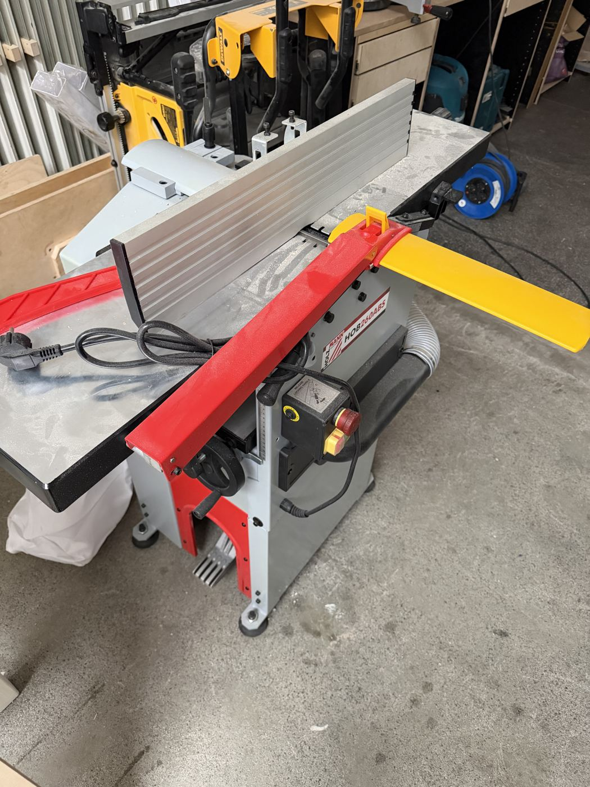

# Holzmann HOB260ABS Planer / Thicknesser

{ width="360" }

| | |
|---|---|
| **Access** | Woodworking 101 Required |
| **PPE** | Safety glasses, hearing protection (it's loud: around 96 dB). No gloves. |
| **Use it for** | Flattening a face and squaring an edge (jointing), then bringing boards to an even thickness (thicknessing) |
| **Product page** | [holzmannshop24.de](https://www.holzmannshop24.de/p/holzmann-hobelmaschine-hob260abs-230v-mit-integrierter-absaugung-lagernd) |

## Safety

!!! danger "The cutter head is exposed on top of the jointer"
    Keep your hands flat on top of the board and never pass them directly over the cutter head. Use push blocks for anything thinner than about 50 mm or shorter than about 30 cm.

- **The guard must cover the cutter head** for every jointing pass. Set it so only the width of your board is exposed.
- **Feed with the grain.** Against the grain the knives tear out chunks and the board can jump.
- **No short pieces.** Anything shorter than about 30 cm can tip into the cutter head or get stuck in the thicknesser. Plane a longer board and cut it to length afterwards.
- **Never look into the thicknesser outfeed** or reach in while it's running. If a board gets stuck, switch off and unplug first.
- **Stand to the side** of the infeed when thicknessing. A board can shoot back out.

## Rules

- Only after completing Woodworking 101.
- **Clean, metal-free wood only.** Check reclaimed wood with a magnet and remove all nails, screws and staples. No painted, glued or dirty wood: paint, glue and grit ruin the knives instantly.
- No plywood, MDF, OSB or other sheet goods.
- Dust extraction on for every pass. Empty the chip bag when it's full.
- Switching between jointing and thicknessing mode changes the guard and table setup. If you haven't done it before, ask.

## How to use

### Jointing (flatten one face, then one edge)

1. Check the board for metal, loose knots and grain direction.
2. Set the cut depth to 1 mm or less. Light passes give a better finish.
3. Adjust the guard to the board's width.
4. Switch on extraction, then the machine. Wait for full speed.
5. Push the board across with steady pressure on the **outfeed** side once it has passed the cutter head. Use push blocks.
6. Repeat until the face is flat. Then hold that face against the fence and joint one edge square.

### Thicknessing (make the opposite face parallel)

1. Switch the machine to thicknessing mode as shown in your training.
2. Set the height to the board's current thickness minus about 1 mm.
3. Feed the board in with the **flat face down**. Let the machine pull it through; don't push or pull.
4. Lower the table about 1 mm per pass, flipping the board end-for-end if you get tear-out.
5. Switch off, wait for the cutter head to stop and clean up.

## Tips

- Thicknessing alone doesn't flatten a warped board. It just makes a thinner warped board. Always joint one face first.
- Plane all boards for a project at the same setting, so they come out exactly the same thickness.
- Snipe (a deeper cut at the ends) is normal. Leave boards a few centimetres long and trim the ends off afterwards.
- Mark the face with a pencil scribble before a pass. When the scribble is gone, the face is flat.

## Specs

| Spec | Value |
|---|---|
| Jointer table | 1050 × 260 mm |
| Thicknessing table | 480 × 254 mm |
| Max workpiece thickness | 160 mm |
| Max cut depth | 3 mm jointing, 2 mm thicknessing |
| Cutter head | 2 knives, 6700 rpm |
| Motor | 1800 W, 230 V |
| Extraction | Built-in, 75 mm port |
