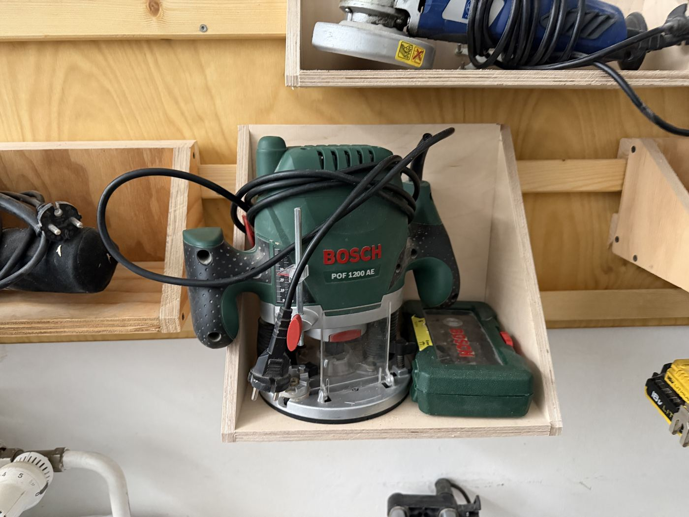

# Bosch POF 1200 AE Plunge Router

{ width="360" }

| | |
|---|---|
| **Access** | Woodworking 101 Required |
| **PPE** | Safety glasses, hearing protection, dust mask. No gloves. |
| **Use it for** | Grooves and dados, mortises, edge profiles, copying a shape from a template |

## Safety

!!! danger "Feed direction"
    Move the router **against** the bit's rotation. On an outside edge, that means left to right as you face the edge (anticlockwise around the workpiece). Feeding the wrong way makes the router grab and run away along the edge.

- **Clamp the workpiece.** You need both hands on the router.
- **Start and stop with the bit clear of the wood.** Plunge only once it's at full speed, and let the bit stop before you lift the router away.
- **Tighten the collet properly** and insert at least ¾ of the bit's shank. A loose bit can fly out.
- **Take shallow passes**, about 3–5 mm deep at a time. Deep cuts in one pass overload the router and make it grab.

## Rules

- Only after completing Woodworking 101.
- Unplug before changing bits.
- Use the bits from the shop's router bit case. Report damaged or burnt bits.
- Connect the dust extractor when possible.

## How to use

1. Fit the bit, tighten the collet, and set the cut depth with the depth stop.
2. Clamp the work. Guide the router with the parallel fence, a clamped straightedge, or a template and guide bushing.
3. Set the speed: lower for large-diameter bits, higher for small bits.
4. Switch on with the bit clear of the wood, plunge, lock, and move steadily in the right direction.
5. Release the plunge, switch off and wait for the bit to stop.

## Tips

- Cut deep grooves in several passes, lowering the depth stop a few millimetres each time.
- Burn marks mean you're moving too slowly or the speed is too high.
- For small edge profiles, the lighter [edge router](edge-router.md) is easier to handle.

## Specs

| Spec | Value |
|---|---|
| Motor | 1200 W |
| Speed | Variable, about 11,000–28,000 rpm |
| Plunge depth | 55 mm |
| Collets | 6 mm and 8 mm (check which one is fitted) |
