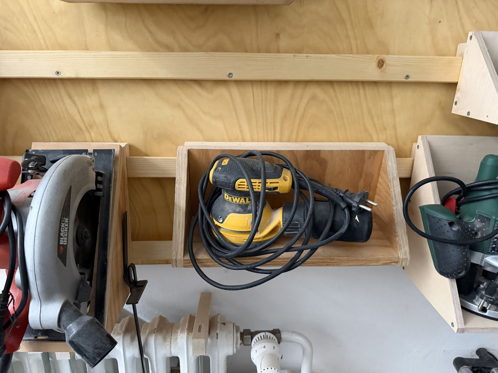

# DeWalt Random Orbit Sander

{ width="360" }

| | |
|---|---|
| **Access** | Open |
| **PPE** | Dust mask (FFP2), safety glasses. Hearing protection for long sessions. |
| **Use it for** | Sanding flat surfaces smooth before finishing |

## Safety

- **Wear a dust mask.** Fine sanding dust stays in the air long after you've finished. MDF dust and dust from hardwoods like oak are especially harmful.
- **Connect it to the dust extractor** or at least empty and fit the dust bag.
- **Clamp small pieces.** The sander can fling them across the shop.
- Unplug before changing sanding discs.

## Rules

- Hook-and-loop sanding discs only, with holes lined up with the holes in the pad.
- Report a worn pad (discs won't stick any more).
- Don't sand paint unless you're sure it's not old lead paint.

## How to use

1. Fit a disc with the holes lined up.
2. Put the sander on the work, **then** switch it on, so it doesn't gouge the surface.
3. Move it slowly in overlapping passes, letting its own weight do the work. Don't press.
4. Lift it off only after you've switched it off and it has slowed down.

## Tips

- **Grit order:** start with 80 or 120 depending on how rough the surface is, then 180, then 240 for a finish. Don't skip more than one grit step, or the scratches from the coarse grit stay visible.
- Wipe the surface between grits so loose coarse grit doesn't scratch the next pass.
- Pencil-scribble the surface before each grit. When the scribble is gone everywhere, move to the next grit.
