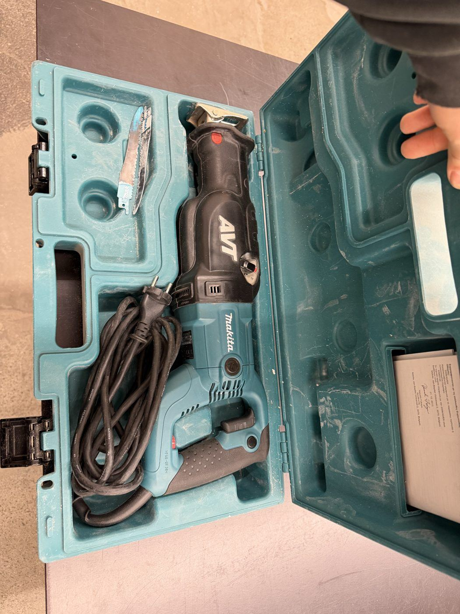
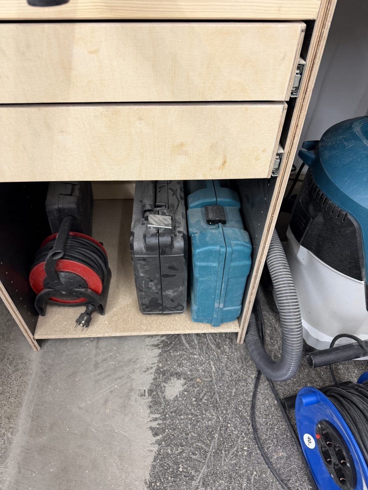

# Makita Reciprocating Saw

{ width="360" }

| | |
|---|---|
| **Access** | Induction |
| **PPE** | Safety glasses, hearing protection, work gloves are OK for this tool |
| **Use it for** | Demolition, cutting through walls and studs, cutting pipes and reclaimed wood with nails in it, rough cuts where accuracy doesn't matter |
| **Where** | In its Makita case under the workbench (photo below) |

## Safety

- **Hold the shoe firmly against the work.** Without the shoe pressed on, the saw shakes violently and the blade can break.
- **Check what's behind your cut.** In a wall or floor that can mean electric cables, water pipes or your own leg.
- **Hold it with both hands.** It kicks hard when the blade catches.
- **The blade gets hot.** Let it cool before you touch it.
- Unplug before changing the blade.

## Rules

- Induction by a shop lead before your first use.
- Use the right blade: wood blades (big teeth) for wood, metal blades (fine teeth) for metal and wood with nails.

## How to use

1. Fit the blade until it clicks and tug it to check it's locked.
2. Press the shoe against the material.
3. Start slowly, then speed up once the blade has made a groove.
4. Let the saw do the cutting. Don't lean on it.

## Tips

- For a cleaner cut, use a longer blade than you think you need. A short blade that just clears the material bends and wanders.
- For precise cuts, use the [band saw](band-saw.md), [circular saw](circular-saw.md) or [track saw](track-saw.md) instead.

## Storage

Put the saw and its blades back in the case and the case back under the workbench.

{ width="360" }
