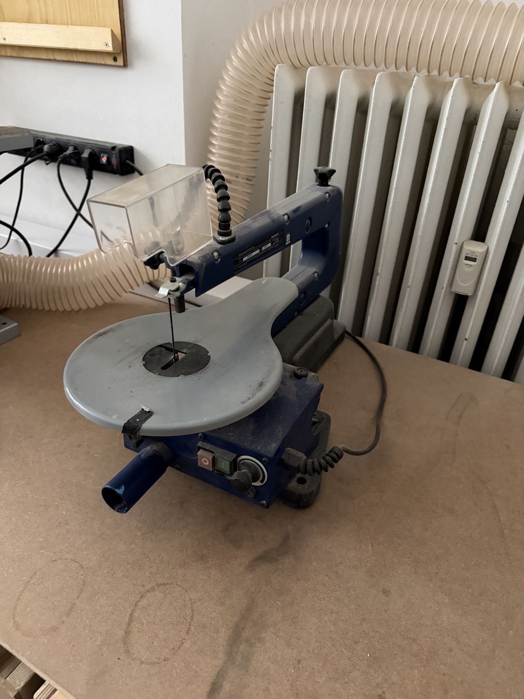

# Einhell Scroll Saw

{ width="360" }

| | |
|---|---|
| **Access** | Induction |
| **PPE** | Safety glasses |
| **Use it for** | Fine curves, small parts, inside cutouts (fretwork) in thin wood, plywood and acrylic |

## Safety

- **Lower the hold-down foot** onto the workpiece for every cut. It stops the work from jumping up and down with the blade.
- **Keep your fingers at the sides of the blade**, never directly in front of it.
- **Don't force the work.** A blade that's pushed too hard breaks, and the work can jump.
- Switch off and unplug before you change or re-thread a blade.

## Rules

- Induction by a shop lead before your first use.
- Thin material only: up to about 40 mm of softwood, less for hardwood. _[confirm with saw's manual]_
- Don't leave broken blades in the machine. Replace them, and report it if there are no spares.

## How to use

1. Check the blade is tight and the teeth point **down** toward the table.
2. Set the hold-down foot so it just touches your workpiece.
3. Switch on, then set the speed. Slower for hard material and tight curves, faster for soft wood.
4. Feed gently, turning the work, not pushing it sideways against the blade.
5. For an inside cutout: drill a hole in the waste, release the blade at the top, thread it through the hole, re-tension it and cut.

## Tips

- Stick a paper printout of your pattern onto the wood with spray adhesive or a glue stick, then cut along the lines.
- Cutting several identical thin parts? Tape the sheets together and cut them as a stack.
- Burning means the blade is dull or the speed is too high.
