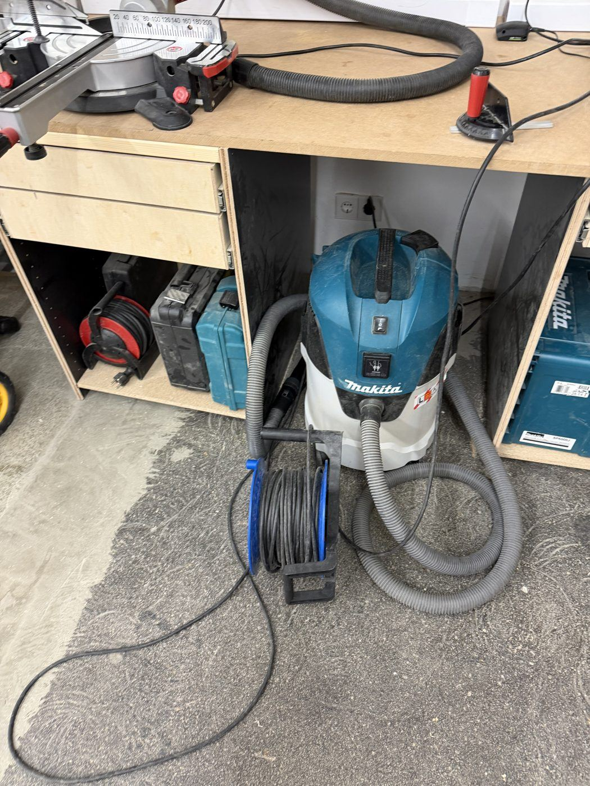
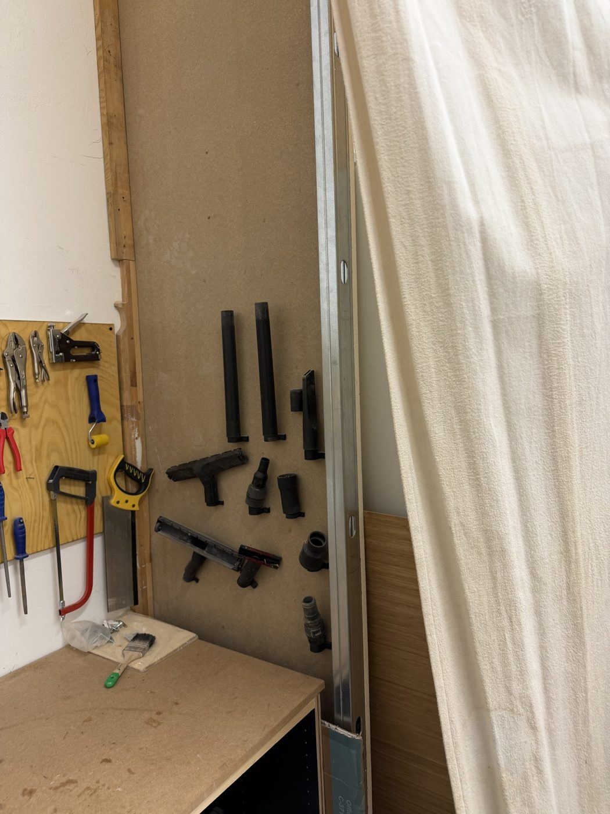

# Makita Shop Vac

{ width="360" }

| | |
|---|---|
| **Access** | Open |
| **Use it for** | Dust extraction on hand-held power tools (track saw, sanders, routers), and cleaning up your workspace |
| **Where** | Under the mitre saw bench. Hoses, nozzles and tool adapters hang on the wall next to the hand tool wall (photo below). |

## Safety

- **Never vacuum up** hot ash, glowing sparks or metal from the [angle grinder](angle-grinder.md). Hot particles can smoulder in the bag and start a fire hours later.
- **No flammable liquids or solvents**, and no fumes from them.
- **Liquids only** if the vac has been set up for wet use. Ask a shop lead first.
- The vac is rated for normal workshop dust. Fine dust from MDF and hardwoods is harmful, so wear a dust mask when sanding even with the vac connected.

## Rules

- **Empty the bag or bin when it's full.** A full vac has almost no suction. Report it if there are no spare bags.
- **No drywall or plaster dust, screws or other debris.** Fine plaster dust clogs the filter immediately.
- Put the hose and attachments back on the wall when you're done.
- Roll up the cable. Don't leave it across the walkway.

## How to use

### As dust extraction for a power tool

1. Connect the hose to the tool's dust port. Use an adapter from the wall if it doesn't fit directly.
2. Plug the tool into the **power socket on the vac** and set the vac's switch to **auto**.
3. The vac now starts when you switch on the tool, and runs on for a few seconds after you switch it off to clear the hose.

### For cleaning up

1. Fit a floor nozzle or crevice tool from the wall.
2. Set the switch to **on** (not auto).
3. Vacuum your machine and the floor around it.

{ width="360" }

## Tips

- If suction drops, check in this order: full bag, clogged filter, blocked hose (often at the tool adapter).
- Most vacs have a filter-cleaning button that shakes dust off the filter. Press it a few times when suction drops.
