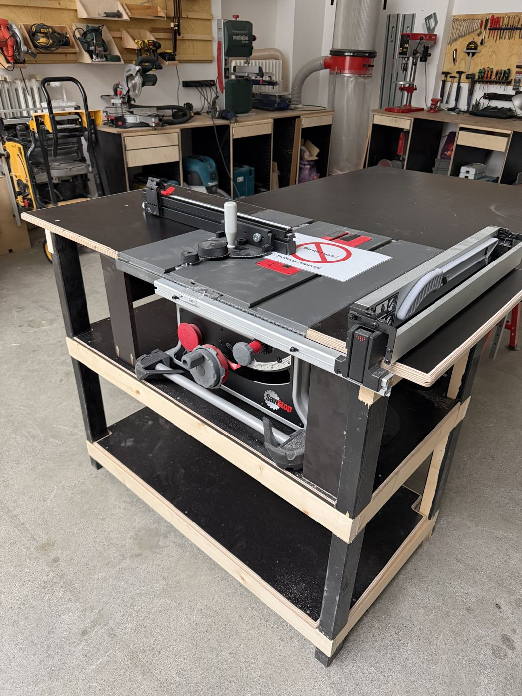

# SawStop Compact Table Saw

{ width="360" }

| | |
|---|---|
| **Access** | Woodworking 101 Required |
| **PPE** | Safety glasses, hearing protection. No gloves. |
| **Use it for** | Ripping boards to width, crosscutting with the mitre gauge, cutting sheet goods to size |
| **Product page** | [sawstop.eu](https://sawstop.eu/product/compact-table-saw/) |

## Safety

!!! danger "The SawStop brake is a backup, not a reason to relax"
    The saw detects skin contact and stops the blade in a few milliseconds. That limits an injury to a nick instead of an amputation, but it does nothing against **kickback**, which is the most common table saw injury. Every rule below still applies.

- **Kickback** happens when the wood pinches the back of the blade or twists between blade and fence, and the saw throws it back at you. Prevent it by keeping the riving knife and blade guard on, holding the work flat and tight against the fence, and never cutting freehand.
- **Stand to the side** of the blade, never directly behind it.
- **Use a push stick** whenever your hand would come within 15 cm of the blade. On narrow rips that's the whole cut.
- **Never use the fence and the mitre gauge together** on the same cut. An offcut trapped between blade and fence will kick back.
- **Never reach over or behind a spinning blade** to grab an offcut. Wait for the blade to stop.
- **Wet or conductive material** (green wood, wet pressure-treated wood, foil-faced boards) can trigger the brake. A flashing light on the control box warns you. Ask a shop lead; don't switch to bypass mode yourself.

## Rules

- Only after completing Woodworking 101.
- **Riving knife always fitted.** Blade guard on for all through-cuts.
- No dado stacks. The Compact model doesn't support them.
- No metal, no stone, no plastics unless a shop lead approves the blade and material.
- If the brake fires, **stop and tell a shop lead**. Don't try to remove the cartridge or blade yourself. A brake activation costs a new cartridge and usually a blade, so cutting carelessly costs the space real money.

## How to use

1. **Check the saw.** Unplugged, blade sharp and clean, riving knife and guard fitted, table clear.
2. **Set the blade height** so the teeth stick out about 5 mm above the top of your board.
3. **Set the fence** to your width and measure from the fence to a tooth that points toward it. Lock the fence.
4. **Dust extraction on**, then switch the saw on and wait until it reaches full speed.
5. **Feed steadily.** Keep the board pressed down and against the fence. Don't stop halfway, and push all the way past the blade with a push stick.
6. **Switch off** and wait until the blade has stopped completely before you remove offcuts.
7. **Lower the blade** below the table and clean up.

## Tips

- One edge of your board has to be straight before you rip it. Joint it on the [planer](planer-thicknesser.md) first.
- For crosscuts, use the mitre gauge with a sacrificial fence screwed to it. Long boards are easier and safer on the [mitre saw](mitre-saw.md).
- Burn marks usually mean a dull blade, a feed rate that's too slow, or a fence that isn't parallel to the blade. Report it.
- Large sheets: break them down first with the [track saw](track-saw.md). Wrestling a full sheet on a compact saw is how kickback happens.

## Specs

| Spec | Value |
|---|---|
| Blade | 254 mm (10″), 30 mm bore |
| Max cut depth | 80 mm at 90°, 56 mm at 45° |
| Rip capacity | 622 mm right of the blade |
| Blade tilt | -2° to 47° (left) |
| Motor | 1800 W, 230 V |
| Dado | Not supported |
