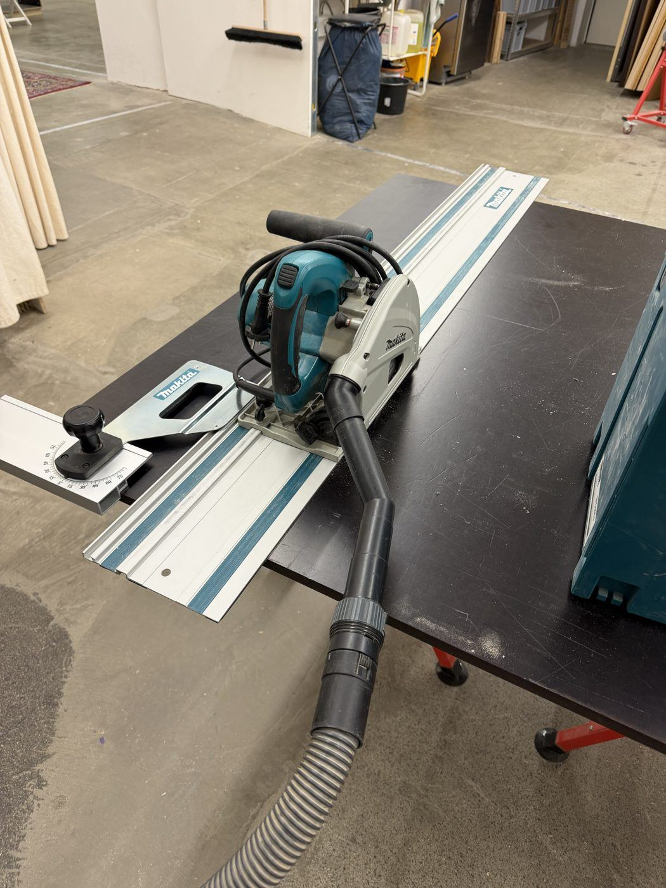
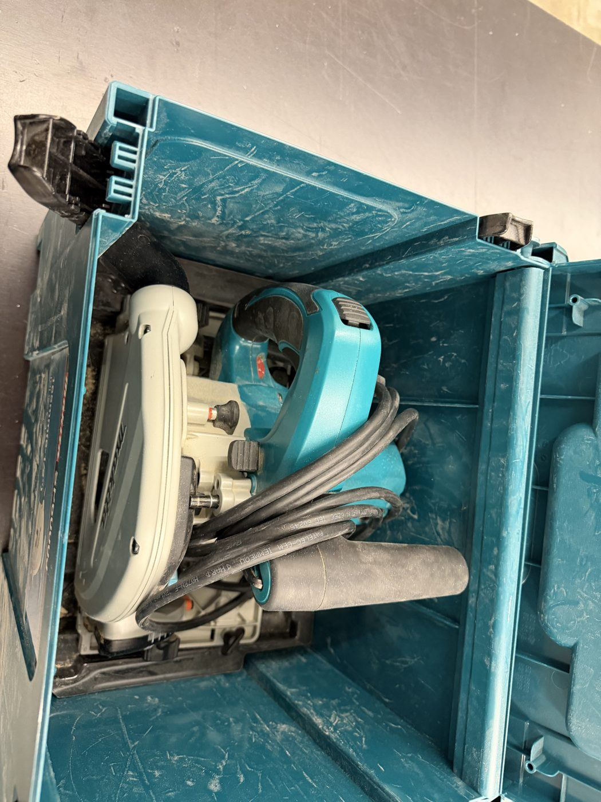
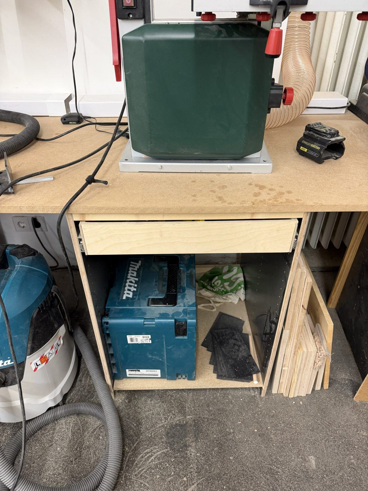

# Makita Track Saw (SP6000)

{ width="360" }

| | |
|---|---|
| **Access** | Woodworking 101 Required |
| **PPE** | Safety glasses, hearing protection, dust mask for MDF. No gloves. |
| **Use it for** | Cutting full plywood and MDF sheets into manageable pieces, perfectly straight cuts on long panels |
| **Where** | In its Makita case under the band saw bench. Guide rails: _[confirm location]_ |
| **Product page** | [Makita SP6000](https://www.bueromarkt-ag.de/tauchsaege_makita_sp6000_handkreissaege,p-sp6000.html) |

## Safety

- **Support both sides of the cut.** Lay the sheet on foam insulation board or sacrificial battens on the floor or a table, so neither piece falls or pinches the blade when the cut is finished.
- **Set the plunge depth** so the blade goes about 5 mm below the material, not more.
- **Keep the cord behind the saw** and out of the cut path.
- **Kickback:** if the saw catches, it can climb back toward you. Stand to the side of the track, keep both hands on the handles and push steadily.
- **Wait for the blade to stop** before lifting the saw off the track.

## Rules

- Only after completing Woodworking 101.
- Wood-based materials only.
- Connect it to the dust extractor whenever possible.
- Use the [aluminium track saw](aluminium-saw.md) for aluminium. This saw is for wood only.
- Keep the tracks flat and don't stand on them. A bent track can't cut straight.

## How to use

1. Mark both ends of your cut. Line the track's rubber splinter edge up with the marks. That edge is exactly where the blade cuts.
2. Clamp the track if the sheet is small or the track might slide.
3. Set the cut depth: material thickness plus about 5 mm.
4. Place the saw at the start of the track, switch on, plunge, and push steadily through the cut.
5. Let the blade stop, then lift the saw off.

## Tips

- Cut with the good face **up**. The rubber edge on the track keeps the top surface free of splinters.
- Break sheets down roughly here, then do the final, exact cuts on the [table saw](table-saw.md).

## Specs

| Spec | Value |
|---|---|
| Blade | 165 mm |
| Max cut depth | 56 mm at 90°, 40 mm at 45° |
| Bevel | -1° to 48° |
| Speed | 2200–6400 rpm, adjustable |
| Motor | 1300 W, soft start |

## Storage

Put the saw back in its Makita case and the case back under the band saw bench.

{ width="300" }
{ width="300" }
